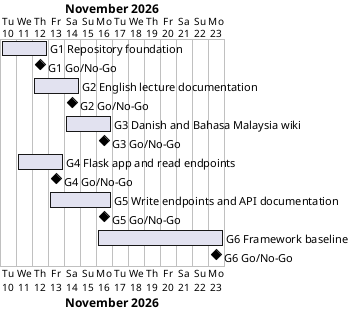

# Project Plan

## Metadata
| Key | Value |
| --- | --- |
| ID | PP-001 |
| CrossReference | [BC-001], [SA-001], [MIL-001], [MIL-002], [MIL-003], [MIL-004], [MIL-005], [MIL-006] |
| Language | en |
| Domain | education |

## Version History
| Date | Status | Author | Reviewer | Change | Commit |
| --- | --- | --- | --- | --- | --- |
| 2026-11-11 | Deprecated | Jens Tirsvad Nielsen | AI as stand-in for S01 | Removed the repository description and topics from the G1 deliverable and the Scope Coverage row<br>Accepted on a Go review, RC-021; supervised, not independent | [f5e83b8] |
| 2026-11-11 | Deprecated | Jens Tirsvad Nielsen | AI as stand-in for S01 | Spelled out API on first use in the body (optional criterion 10 of QC-LANG-001)<br>Accepted on a Go review, RC-026; supervised, not independent | [9086ee4] |
| 2026-11-16 | Accepted | Jens Tirsvad Nielsen | AI as stand-in for S01 | Added the baseline gateway MIL-006 (G6) with its schedule row, scope coverage, dependency, risk and Gantt entries; recorded the move of the end date, the domain, the open pull request #57, the prompt log, the open milestones, the new traceability matrix and the CI in the Planning Assumptions and Open Issues; replaced `not yet synced` in the milestone column of the five earlier gateways with the links to their milestones on the git host; set the domain to education; reviewed in autonomous mode, not independent | pending |

---

## Purpose

This plan schedules five gateways inside the one-week constraint of [BC-001], from 2026-11-10 to 2026-11-17: G1 to G3 deliver the Day 66 README and trilingual wiki, G4 and G5 deliver the Flask cafe application programming interface (API). Since the baseline gateway [MIL-006] (G6) a sixth phase brings the finished project to the baseline of the framework and ends 2026-11-23.

## Planning Assumptions

- The project starts 2026-11-10 and ends by 2026-11-17, per the Business Case constraint.
- Each gateway is one branch and one pull request. Gateway length is two to three days.
- S01 owns and approves every gateway, as in [SA-001]; the AI acts as stand-in in autonomous mode.
- The baseline gateway G6 (MIL-006) starts 2026-11-16 and ends 2026-11-23, one week (source: [BC-001], Constraints). It brings the finished project to the baseline of the framework, a decision of S01. The decision dates of the five earlier gateways stay as they were, so the end date of the plan moves from 2026-11-17 to 2026-11-23.
- For MIL-006 S01 has authorised the assistant to commit, push, open the pull request and merge it, and the review is done by an AI stand-in for S01 (source: [BC-001], Constraints and Risks).
- The PO language is English; the domain is IT until [MIL-006] and education since.
- Screenshots come from S01 or public pages (see Open Issues).
- G1, G2 and G3 reached Go on 2026-11-10 (RC-004, RC-005, RC-006), ahead of the decision dates in the table; their planned dates stay as the baseline. G4 depends on G2 only, so it can run beside G3's planned window and is decided after G2.
- G4 and G5 are code gateways: nothing goes under `src/` or `tests/` until the gateway is `Accepted` with a `Go` review, and each is reviewed against `qc-programming-python` before its pull request.

## Gateway Schedule

| Gateway | Document | Window | Decision date | Owner | Stories | Main deliverable | Milestone |
| --- | --- | --- | --- | --- | --- | --- | --- |
| G1 Repository foundation | [MIL-001] | 2026-11-10 to 2026-11-12 | 2026-11-12 | S01 | none (technical tasks) | Project configuration, README skeleton, scan | [Milestone 415][ms-415] |
| G2 English lecture documentation | [MIL-002] | 2026-11-12 to 2026-11-14 | 2026-11-14 | S01 | none (documentation tasks) | English wiki, README steps, screenshots | [Milestone 416][ms-416] |
| G3 Danish and Bahasa Malaysia wiki | [MIL-003] | 2026-11-14 to 2026-11-16 | 2026-11-16 | S01 | none (documentation tasks) | Danish and Bahasa Malaysia wiki, language links | [Milestone 417][ms-417] |
| G4 Flask app and read endpoints | [MIL-004] | 2026-11-11 to 2026-11-13 | 2026-11-13 | S01 | none (technical tasks) | Layered package, `Cafe` model, `GET /random`, `/all`, `/search`, tests | [Milestone 446][ms-446] |
| G5 Write endpoints and API documentation | [MIL-005] | 2026-11-13 to 2026-11-16 | 2026-11-16 | S01 | none (technical tasks) | `POST /add`, `PATCH /update-price`, `DELETE /report-closed` with API key, tests, API docs in three languages | [Milestone 447][ms-447] |
| G6 Framework baseline | [MIL-006] | 2026-11-16 to 2026-11-23 | 2026-11-23 | S01 | none (technical tasks) | Branch `mil-006-framework-baseline` merged: the adopted framework release, the README, project URL and licence metadata, `.editorconfig`, `.env.example`, the traceability matrix and review records | [Milestone 587][ms-587] |



## Scope Coverage

| Business Case scope item | Gateway |
| --- | --- |
| Repository setup (.gitignore, pyproject.toml, Doxyfile, folders) | G1 |
| README with lecture steps, screenshots, venv, run and test instructions | G1 (skeleton and instructions), G2 (steps and screenshots) |
| Wiki in English | G2 |
| Wiki in Danish and Bahasa Malaysia | G3 |
| A screenshot for each lecture step | G2 (README and English wiki), G3 (translated pages) |
| Flask cafe API: read endpoints, layered structure, tests | G4 |
| Flask cafe API: write endpoints with API key, tests | G5 |
| API documentation in the README and the wiki | G5 |
| Opengrep scan and AI prompt log | G1, G2, G3, G4, G5 |
| The baseline: framework release, README, project URL and licence metadata, editor settings, environment template, traceability matrix, review records (objective 8) | G6 ([MIL-006]) |

## Dependencies

```
G1 → G2 → G3
G2 → G4 → G5
G5 → G6
```

A No-Go at a gateway returns that gateway to S01 for rework; later gateways move by the same number of days. S01 alone decides to move the end date of 2026-11-17.

## Plan Risks

| Risk | Impact | Mitigation |
| --- | --- | --- |
| Screenshots are not available (BC-001 risk 1) | G2 cannot reach Go | Ask S01 for the screenshots at plan acceptance; no placeholder without S01's consent |
| A pending language criterion needs S01 | A gateway is Go-with-conditions only | S01 confirms the pending criteria at plan acceptance or at the gateway |
| Translations take longer than planned | G3 slips | G3 has a one-day buffer before 2026-11-17 |
| The code gateways overrun the one-week constraint | G5 slips past 2026-11-17 | G4 starts now, in parallel with the end of the documentation work; S01 decides to drop or move G5 |
| New code resembles the copyrighted lecture code | Legal exposure | Write from the lecture description and the wiki, own seed data, never the course archive |
| A continuous integration (CI) check fails on the pull request of [MIL-006] | The merge is delayed past 2026-11-23 | The failure is fixed on the same branch and the checks run again; after three failed rounds on one cause the work stops and S01 decides (trace: success criterion 10 of [BC-001]) |

## Open Issues

- Source of the screenshots for each lecture step: S01 supplies them, or S01 allows screenshots of public pages.
- The endpoints are planned as plain technical tasks that cite the wiki step they implement. S01 decides whether they also need user stories (which need a Use Case Diagram first); the plan assumes not.
- The Python coding rules (`constants.py`, pytest tests, Doxygen comments) apply from G4.
- The `src/` and `tests/` folders hold only a README each.
- The point above describes the plan before G4; since G4 and G5 the folders hold the program and its tests.
- Domain: since [MIL-006] the plan, the Business Case and the baseline milestone have the domain `education`. The other documents (Stakeholder Analysis, milestones MIL-001 to MIL-005 and the review records RC-001 to RC-028) keep the domain `it` they were accepted with; they are not changed by the baseline, and a change of their domain would need a new review of each.
- The git host also has the open pull request #57 (framework submodule URL in lowercase); the baseline delivers the same change in the pull request of MIL-006. The baseline does not close #57 on the host; S01 decides what happens to it after the merge.
- The milestones 446 (G4) and 447 (G5) on the git host are still open although every issue in them is closed; the baseline closes none of them, and S01 decides.
- The prompt log `docs/ai-prompts/` is listed in `.gitignore` and not tracked; MIL-006 keeps its own prompt log in a new session folder there and does not change the existing ones.
- The project has no workflow file of its own; the pull request of MIL-006 is the first one that the shared CI checks of the git host run on.
- The repository has no traceability matrix before MIL-006; MIL-006 adds TM-001. The framework has no quality checklist for the Traceability Matrix, so TM-001 has no review record of its own; its Last Reviewed column names the records of the documents it lists.
- No SQLite database file is tracked (`instance/` and `*.db` are ignored), and no secret is in the repository: the API key comes from the environment variable `CAFE_API_KEY`.


---

[BC-001]: ./business-case.md
[SA-001]: ./stakeholder-analysis.md
[MIL-001]: ./milestones/mil-001-repository-foundation.md
[MIL-002]: ./milestones/mil-002-english-lecture-documentation.md
[MIL-003]: ./milestones/mil-003-danish-and-malay-wiki.md
[MIL-004]: ./milestones/mil-004-read-api.md
[MIL-005]: ./milestones/mil-005-write-api.md
[f5e83b8]: https://git.tirsystem.com/Tirsvad-Udemy-100-days-of-code/066-cafe-api/commit/f5e83b8347928ef17b977474da1f9cce9785bda3
[9086ee4]: https://git.tirsystem.com/Tirsvad-Udemy-100-days-of-code/066-cafe-api/commit/9086ee41f673e467b694c5dc168cf6de17d1d50e
[ms-415]: https://git.tirsystem.com/Tirsvad-Udemy-100-days-of-code/066-cafe-api/milestone/415
[ms-416]: https://git.tirsystem.com/Tirsvad-Udemy-100-days-of-code/066-cafe-api/milestone/416
[ms-417]: https://git.tirsystem.com/Tirsvad-Udemy-100-days-of-code/066-cafe-api/milestone/417
[ms-446]: https://git.tirsystem.com/Tirsvad-Udemy-100-days-of-code/066-cafe-api/milestone/446
[ms-447]: https://git.tirsystem.com/Tirsvad-Udemy-100-days-of-code/066-cafe-api/milestone/447
[MIL-006]: ./milestones/mil-006-framework-baseline.md
[ms-587]: https://git.tirsystem.com/Tirsvad-Udemy-100-days-of-code/066-cafe-api/milestone/587
