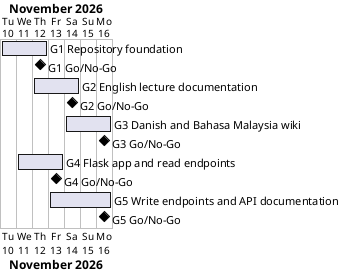

# Project Plan

## Metadata
| Key | Value |
| --- | --- |
| ID | PP-001 |
| CrossReference | [BC-001], [SA-001], [MIL-001], [MIL-002], [MIL-003], [MIL-004], [MIL-005] |
| Language | en |
| Domain | it |

## Version History
| Date | Status | Author | Reviewer | Change | Commit |
| --- | --- | --- | --- | --- | --- |
| 2026-11-10 | Deprecated | Jens Tirsvad Nielsen | AI as stand-in for S01 | Accepted on a Go review, RC-003; autonomous, not independent | [55768bf] |
| 2026-11-11 | Accepted | Jens Tirsvad Nielsen | AI as stand-in for S01 | Add gateways G4 (read API) and G5 (write API and API documentation) after the Business Case scope change<br>Accepted on a Go review, RC-011; supervised, not independent | [37f38a7] |

---

## Purpose

This plan schedules five gateways inside the one-week constraint of [BC-001], from 2026-11-10 to 2026-11-17: G1 to G3 deliver the Day 66 README and trilingual wiki, G4 and G5 deliver the Flask cafe API.

## Planning Assumptions

- The project starts 2026-11-10 and ends by 2026-11-17, per the Business Case constraint.
- Each gateway is one branch and one pull request. Gateway length is two to three days.
- S01 owns and approves every gateway, as in [SA-001]; the AI acts as stand-in in autonomous mode.
- Screenshots come from S01 or public pages (see Open Issues).
- G1, G2 and G3 reached Go on 2026-11-10 (RC-004, RC-005, RC-006), ahead of the decision dates in the table; their planned dates stay as the baseline. G4 depends on G2 only, so it can run beside G3's planned window and is decided after G2.
- G4 and G5 are code gateways: nothing goes under `src/` or `tests/` until the gateway is `Accepted` with a `Go` review, and each is reviewed against `qc-programming-python` before its pull request.

## Gateway Schedule

| Gateway | Document | Window | Decision date | Owner | Stories | Main deliverable | Milestone |
| --- | --- | --- | --- | --- | --- | --- | --- |
| G1 Repository foundation | [MIL-001] | 2026-11-10 to 2026-11-12 | 2026-11-12 | S01 | none (technical tasks) | Repository metadata, project configuration, README skeleton, scan | not yet synced |
| G2 English lecture documentation | [MIL-002] | 2026-11-12 to 2026-11-14 | 2026-11-14 | S01 | none (documentation tasks) | English wiki, README steps, screenshots | not yet synced |
| G3 Danish and Bahasa Malaysia wiki | [MIL-003] | 2026-11-14 to 2026-11-16 | 2026-11-16 | S01 | none (documentation tasks) | Danish and Bahasa Malaysia wiki, language links | not yet synced |
| G4 Flask app and read endpoints | [MIL-004] | 2026-11-11 to 2026-11-13 | 2026-11-13 | S01 | none (technical tasks) | Layered package, `Cafe` model, `GET /random`, `/all`, `/search`, tests | not yet synced |
| G5 Write endpoints and API documentation | [MIL-005] | 2026-11-13 to 2026-11-16 | 2026-11-16 | S01 | none (technical tasks) | `POST /add`, `PATCH /update-price`, `DELETE /report-closed` with API key, tests, API docs in three languages | not yet synced |



## Scope Coverage

| Business Case scope item | Gateway |
| --- | --- |
| Repository setup (description, topics, .gitignore, pyproject.toml, Doxyfile, folders) | G1 |
| README with lecture steps, screenshots, venv, run and test instructions | G1 (skeleton and instructions), G2 (steps and screenshots) |
| Wiki in English | G2 |
| Wiki in Danish and Bahasa Malaysia | G3 |
| A screenshot for each lecture step | G2 (README and English wiki), G3 (translated pages) |
| Flask cafe API: read endpoints, layered structure, tests | G4 |
| Flask cafe API: write endpoints with API key, tests | G5 |
| API documentation in the README and the wiki | G5 |
| Opengrep scan and AI prompt log | G1, G2, G3, G4, G5 |

## Dependencies

```
G1 → G2 → G3
G2 → G4 → G5
```

A No-Go at a gateway returns that gateway to S01 for rework; later gateways move by the same number of days. S01 alone decides to move the end date of 2026-11-17.

## Plan Risks

| Risk | Impact | Mitigation |
| --- | --- | --- |
| Screenshots are not available (BC-001 risk 1) | G2 cannot reach Go | Ask S01 for the screenshots at plan acceptance; no placeholder without S01's consent |
| A pending language criterion needs S01 | A gateway is Go-with-conditions only | S01 confirms the pending criteria at plan acceptance or at the gateway |
| Translations take longer than planned | G3 slips | G3 has a one-day buffer before 2026-11-17 |
| The code gateways overrun the one-week constraint | G5 slips past 2026-11-17 | G4 starts now, in parallel with the end of the documentation work; S01 decides to drop or move G5 |
| New code resembles the copyrighted lecture code | Legal exposure | Write from the lecture description and the wiki, own seed data, never the course archive |

## Open Issues

- Source of the screenshots for each lecture step: S01 supplies them, or S01 allows screenshots of public pages.
- The endpoints are planned as plain technical tasks that cite the wiki step they implement. S01 decides whether they also need user stories (which need a Use Case Diagram first); the plan assumes not.
- The Python coding rules (`constants.py`, pytest tests, Doxygen comments) apply from G4.
- The `src/` and `tests/` folders hold only a README each.

---

[BC-001]: ./business-case.md
[SA-001]: ./stakeholder-analysis.md
[MIL-001]: ./milestones/mil-001-repository-foundation.md
[MIL-002]: ./milestones/mil-002-english-lecture-documentation.md
[MIL-003]: ./milestones/mil-003-danish-and-malay-wiki.md
[MIL-004]: ./milestones/mil-004-read-api.md
[MIL-005]: ./milestones/mil-005-write-api.md
[55768bf]: https://git.tirsystem.com/Tirsvad-Udemy-100-days-of-code/066-cafe-api/commit/55768bf1606cc189d8c6c00cacb762dc5fd04f55
[37f38a7]: https://git.tirsystem.com/Tirsvad-Udemy-100-days-of-code/066-cafe-api/commit/37f38a77d878ac293fe09ee1f5e02a9a4afdce90
